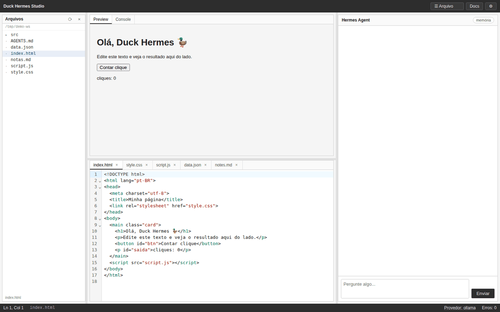

# Duck Hermes Studio — documentação técnica

Arquitetura, endpoints, travas de segurança, fases e empacotamento. Se você só quer **usar** o programa,
comece pelo [README.md](README.md) (guia do usuário).

Editor minimalista com agente de IA. 3 blocos, 2 barras, backend local, frontend no navegador.



## Requisitos

- Node.js 16+ (em Node 18+ usa `fetch` nativo; em Node 16 há um cliente HTTP interno de compatibilidade)
- (Opcional) Ollama, llama.cpp, LM Studio, Deep Rock IA ou chave DeepSeek
- Navegador com suporte a ES modules e import maps para carregar o CodeMirror 6

## Instalação

```bash
git clone https://github.com/SEU_USUARIO/duck-hermes-studio.git
cd duck-hermes-studio && npm install && npm start
```

Acesse http://localhost:3000. O servidor escuta **só em 127.0.0.1** por padrão (ele lê/grava arquivos e
executa comandos); para expor na rede local, defina `HERMES_HOST=0.0.0.0` — faça isso apenas em rede
confiável.

## App para Windows, Linux e macOS

Além de `npm start`, o projeto gera **binários autocontidos** (sem precisar de Node instalado) com
`@yao-pkg/pkg`. O binário sobe o mesmo servidor Express e abre o navegador sozinho.

```bash
npm install          # uma vez
npm run build        # binário da sua plataforma (instala o pkg via npx se preciso)
npm run build:linux  # linux-x64
npm run build:win    # win-x64 (.exe) — cross-compila de qualquer OS
npm run build:mac    # macos-x64 + macos-arm64
```

Saída em `dist/` (~56–75 MB por alvo). Para testar o binário gerado:

```bash
node scripts/smoke-binary.js dist/duck-hermes-studio-linux-x64
```

### Opções do executável

| Opção | Efeito |
|---|---|
| `--port <n>` | porta HTTP (padrão 3000) |
| `--workspace <dir>` | pasta de trabalho do editor (padrão: pasta atual; home se cwd for raiz do disco) |
| `--data <dir>` | histórico, máquinas, devdocs e ai-talk (padrão por SO, veja abaixo) |
| `--no-open` | não abre o navegador |
| `--help` | ajuda |

No app empacotado o snapshot é **somente leitura**, então os dados graváveis vão para uma pasta do usuário:
`%APPDATA%\DuckHermesStudio` (Windows), `~/Library/Application Support/DuckHermesStudio` (macOS) e
`$XDG_DATA_HOME/duck-hermes-studio` ou `~/.local/share/duck-hermes-studio` (Linux). O `.env` **não** é
embutido no binário: chaves de API continuam vindo do ambiente ou de um `.env` na pasta de execução.

### GitHub Actions

[`build.yml`](.github/workflows/build.yml) roda em push para `main`/`master`, em tags `v*` e por **workflow_dispatch**:

| Runner | Alvo | Smoke test |
|---|---|---|
| `ubuntu-22.04` | `linux-x64` | sim (nativo) |
| `ubuntu-22.04` | `linux-arm64` | não (cross-build) |
| `windows-latest` | `win-x64` | sim (nativo) |
| `macos-14` | `macos-x64` | não (cross-build) |
| `macos-14` | `macos-arm64` | sim (nativo) |

O GitHub desativou os runners macOS Intel, então o `macos-x64` é cross-build no runner arm64 (binários
x86_64 do macOS não exigem assinatura para executar). O job instala `@yao-pkg/pkg` com
`npm install --no-save`, confere se o arquivo foi gerado e tem `timeout-minutes` — assim um runner
indisponível falha rápido em vez de ficar pendurado.

Cada job roda `npm ci`, `npm test`, gera o binário e executa o smoke test nele; os binários ficam como
**artefatos** do workflow. Em tags `v*` (ou marcando `release` no dispatch) o job `release` baixa todos os
artefatos e cria a **release** do GitHub com os arquivos anexados.

Alvos aceitos por `scripts/build-app.js`: `linux-x64`, `linux-arm64`, `win-x64`, `macos-x64`,
`macos-arm64` (ou a forma completa `node22-…`). Qualquer outro valor é recusado antes de chegar ao shell.

> Sem assinatura de código: no macOS o Gatekeeper pede confirmação (clique direito → **Abrir**, ou
> `xattr -d com.apple.quarantine duck-hermes-studio-macos-arm64`); no Windows o SmartScreen mostra
> "Mais informações → Executar assim mesmo". Para assinar/notarizar é preciso configurar certificados e
> secrets próprios no workflow.

## Provedores de IA

Detecção automática: Deep_Rock_IA (8080), Ollama (11434), llama.cpp (8081), LM Studio (1234), DeepSeek (chave), OpenRouter e Gemini via relay (chaves).

As chaves (`DEEPSEEK_API_KEY`, `OPENROUTER_API_KEY`, `GEMINI_API_KEY`) podem ser coladas direto no
**⚙ → Celeiro de IAs → Chaves de API** (gravadas em `data/config.json`, modo 0600, mascaradas na UI) ou
virem do ambiente/.env — procurado em `HERMES_ENV_FILE`, na pasta atual e ao lado do servidor, nessa
ordem. **Chave salva pelo app tem prioridade**; removê-la restaura o valor do ambiente.

`config/providers.example.json` continua como referência de configuração.

**Nota DeepSeek:** o modelo padrão no código é `deepseek-flash`. Não use `deepseek-chat` nem `deepseek-coder` (descontinuados); consulte a documentação oficial antes de trocar o identificador.

## Diagnóstico inicial e modo demo (Fase 7)

Na primeira execução o app abre o **Diagnóstico inicial** com todos os candidatos testados na sua máquina:

- **✅ disponível** — já pode ser usado (botão **Usar** troca o provedor na hora);
- **❌ não encontrado** — mostra o motivo (`não respondeu em 500ms`, `chave não configurada`) e a dica de instalação;
- comandos de instalação vêm com botão **copiar** (`ollama serve`, `docker compose …`, `DEEPSEEK_API_KEY`);
- o **Modo demo** aparece como **sempre disponível**.

O painel abre sozinho só na primeira execução (flag `duck-hermes-onboarded` no `localStorage`) e pode ser
reaberto clicando em **Provedor: …** na barra inferior, no banner do chat ou pelo botão **Redetectar**.

**Modo demo:** sem provedor, nada é enviado para fora. O chat responde sempre com a mensagem fixa
`Nenhum provedor de IA disponível. Configure um em ⚙️ → Celeiro de IAs.` e o banner do chat lembra que a IA
não está conectada — enquanto isso, editor, preview, console, visualizadores, árvore de arquivos, abrir/salvar,
DevDocs e AGENTS.md continuam funcionando.

A detecção automática só troca para `demo` quando **nenhum** candidato responde; escolher `demo` manualmente
é respeitado e fica salvo.

## Visualizador contextual (Bloco 2)

As abas do Bloco 2 mudam conforme o tipo do arquivo ativo:

| Arquivo | Abas | Comportamento |
|---|---|---|
| `index.html` | Preview / Console | iframe sandbox com CSS e JS do projeto injetados |
| `style.css` | Preview / Console | iframe com o HTML do projeto |
| `script.js` | Executar / Console | executa o script num iframe isolado |
| `data.json` | Árvore / Texto | árvore colapsável (`<details>`) ou JSON formatado |
| `*.py` | Código / Executar / Console | fonte com números de linha e execução aprovada no backend |
| `notes.md` | Preview / Texto | Markdown renderizado no navegador ou fonte |
| `*.yaml`, `*.yml` | Árvore / Texto | estrutura por indentação (chaves e itens) ou fonte |
| `*.toml` | Árvore / Texto | estrutura por seções (`[seção]`, `chave = valor`) ou fonte |
| `*.rs`, `*.go`, `*.c`, `*.sh`, `*.sql`, `*.xml`… | Código / Texto | CodeMirror **somente leitura** com highlight (modo carregado sob demanda) ou fonte |
| `*.png`, `*.jpg`, `*.svg`, `*.gif`… | Imagem | `` servido por `/api/fs/raw`, com **Abrir externo** |
| `*.pdf` | PDF | `<embed type="application/pdf">` com **Abrir externo** |
| binário desconhecido | Binário | aviso + **Abrir externo** (nada de lixo no editor) |
| outros | Texto | conteúdo bruto, somente leitura |

Imagem, PDF e binário abrem numa **aba somente leitura**: o editor fica desabilitado (`Ctrl+S` responde
"Somente leitura") e essas abas não são gravadas no `localStorage` — ao recarregar, só os arquivos de texto
voltam. As árvores de YAML/TOML são um *outline* (chaves, itens e seções com valores truncados), não um
parser completo; o próprio painel avisa isso.

O endpoint `GET /api/fs/raw?path=…` serve o arquivo cru com o `Content-Type` correto (até 8 MB), passa
pelas travas do workspace (sem `..`, sem `.git`) e é usado tanto pelo preview quanto pelo **Abrir externo**.

O botão "Executar" da barra superior atualiza o visualizador do arquivo ativo. O Console mostra `console.log`, `console.warn`, `console.error`, exceções e promises rejeitadas vindas do iframe, com timestamp, e alimenta o contador "Erros" da barra inferior.

## Python viewer e execução (Fase 6)

Arquivos `.py` ganham três abas no Bloco 2: **Código** (fonte com número de linha),
**Executar** (resultado da última execução, por arquivo) e **Console**.

Executar um arquivo Python usa o endpoint `POST /api/exec`, que **exige aprovação**:

1. O app pede o comando (`python3 arquivo.py`) ao backend.
2. Se o comando nunca foi aprovado, o backend responde `428` com um `approvalId` e o app abre o
   modal **Aprovar execução**, mostrando comando, diretório, timeout e estado da rede.
3. **Executar** roda e mostra código de saída, duração e saída padrão/erro; **Cancelar**/**Esc**
   não executa nada e a próxima tentativa pede aprovação de novo.

### Travas de segurança

| Trava | Implementação |
|---|---|
| Aprovação obrigatória | primeira vez por comando/diretório; vale 10 min |
| Timeout | 30 s por padrão, máximo 120 s (processo é morto) |
| `cwd` restrito | qualquer caminho fora da raiz do workspace → `403` |
| Sem `sudo` | `sudo`, `su`, `doas`, `rm -rf /`, `mkfs`, `dd if=` → `403` |
| Binários permitidos | `python3`, `python`, `node`, `npm`, `npx`, `pytest`, `make`, `bash`, `sh` |
| Sem shell | argumentos são tokenizados (aspas simples/duplas) e passados via `execFile`, sem interpretação |
| Rede desligada | `http(s)_proxy` apontado para uma porta morta (melhor esforço, não é sandbox); habilitável só pela API/Configurações |
| Histórico | últimas 30 execuções em `data/exec-history.json`, expostas em `GET /api/exec/history` |

> A trava de rede é **best-effort**: quebra clientes que respeitam `http_proxy`, mas não é um
> sandbox de sistema. Para isolamento real, rode o app/runner dentro de um container.

Endpoints: `POST /api/exec`, `POST /api/exec/approve`, `GET /api/exec/history`,
`GET /api/exec/status`, `POST /api/exec/network { enabled }`.

## Chaves de API (Celeiro)

`services/config.js` mantém `KEY_PROVIDERS` (id, nome, variável de ambiente, link oficial) e grava as
chaves em `data/config.json`:

```json
{ "keys": { "deepseek": { "value": "sk-…", "savedAt": "2026-…" } } }
```

| Aspecto | Comportamento |
|---|---|
| Entrada | `POST /api/config/keys { id, key }` — normaliza (remove `Bearer`, aspas, espaços e quebras), exige 16–400 caracteres e sem espaços internos |
| Remoção | `DELETE /api/config/keys/:id` — apaga e restaura o valor anterior de `process.env`, se havia |
| Aplicação | `applyStoredKeys()` no boot e a cada save/remove; chave do app **sobrescreve** o ambiente |
| Detecção | o save/remove chama `invalidateCache()` para o celeiro refletir na hora |
| Exposição | `publicKeys()` devolve só `configured`, `source` (`app`/`ambiente`) e `hintValue` mascarado |
| Arquivo | `config.json` com `mode 0o600` (no Windows o `chmod` é ignorado) |

No frontend, a seção **Chaves de API** do modal ⚙ (`#api-keys`) monta uma linha por provedor com campo
`type=password`, **Salvar**, **mostrar/ocultar**, **Remover** (quando a chave é do app) e link para obter
a chave. Os cartões de provedores com `keyEnv` ganham o atalho **Colar chave** que foca o campo; o painel
de diagnóstico também oferece esse botão.

Chaves **não** são validadas contra a API (diferente do token do GitHub): um valor errado só aparece
como erro 401/402 na primeira conversa. Isso evita chamadas e custo a cada colagem.

Endpoints: `GET /api/config/keys`, `POST /api/config/keys`, `DELETE /api/config/keys/:id`.

## Celeiro de IAs (⚙)

O botão **⚙** abre o **Celeiro de IAs**, que mostra todos os candidatos com ✅/❌ e a dica de instalação:

| Ordem | Provedor | Endpoint |
|---|---|---|
| 1 | Deep Rock IA | `127.0.0.1:8080/health` |
| 2 | Ollama | `127.0.0.1:11434/api/tags` |
| 3 | llama.cpp | `127.0.0.1:8081/v1/models` |
| 4 | LM Studio | `127.0.0.1:1234/v1/models` |
| 5 | Docker (teste) | `127.0.0.1:8090/v1/models` |
| 6 | DeepSeek (nuvem) | chave `DEEPSEEK_API_KEY` |
| 7 | OpenRouter (relay) | chave `OPENROUTER_API_KEY` |
| 8 | Gemini (relay) | chave `GEMINI_API_KEY` |
| 9 | Máquinas da rede | cadastradas por você |
| 10 | Modo demo | sempre disponível |

Cada provedor disponível pode ser escolhido com **Usar**; a escolha fica salva e aparece na barra inferior e no chat. **Redetectar** refaz a detecção sem reiniciar o app.

### Docker de teste

O projeto inclui um LLM simulado compatível com OpenAI para testar o celeiro sem gastar tokens:

```bash
docker compose -f docker/test-llm/docker-compose.yml up -d --build
```

Sobe em `http://127.0.0.1:8090/v1` (modelo `docker-test`) e passa a aparecer como ✅ no Celeiro.
Para derrubar: `docker compose -f docker/test-llm/docker-compose.yml down`.
Personalize com `HERMES_DOCKER_LLM_URL` e `HERMES_DOCKER_LLM_MODEL`.

### Máquinas e runner (rede local)

No Celeiro, em **Máquinas da rede local**, cadastre uma máquina com nome, host/IP, usuário SSH, porta e papel:

| Papel | O que faz |
|---|---|
| `runner` | Executa o comando de teste no projeto — localmente se o host for `127.0.0.1`/`localhost`, ou via SSH na máquina da rede |
| `llm` | Entra no celeiro como provedor OpenAI-compatible (`llmUrl`) |
| `both` | As duas coisas |

O runner é pensado para a máquina que tem Docker: o comando padrão é `npm test`, mas pode ser algo como
`docker compose run --rm tests`. Cada execução mostra saída, código de saída, duração e modo (`local`/`ssh`),
e fica registrada em `GET /api/runner/history` (últimas 20).

**Travas do runner:** comandos só podem começar com `npm`, `node`, `npx`, `docker`, `python3`, `pytest`, `make`, `bash` ou `sh`;
caracteres de encadeamento (`;`, `&&`, `|`, crases, `$`, redirecionamentos) são recusados; timeout de 180s;
conexão SSH não interativa (`BatchMode`) com `ConnectTimeout=5`. As máquinas ficam em `data/machines.json`.

### Endpoints do celeiro

`GET /api/farm`, `POST /api/farm/refresh`, `GET|POST /api/machines`,
`DELETE /api/machines/:id`, `POST /api/machines/:id/probe`, `POST /api/machines/:id/run-tests`,
`GET /api/runner/history`.

## Abrir e salvar arquivos

A barra superior tem **Abrir**, **Salvar** e **Salvar como**. Ambos os diálogos mostram a
**raiz do workspace** no topo e o caminho relativo do arquivo escolhido.

| Ação | O que faz |
|---|---|
| **Abrir** | Navega o workspace (pastas e arquivos) ou aceita um caminho digitado; o arquivo abre numa aba do editor |
| **Salvar** | Grava a aba ativa no caminho mostrado na barra inferior; se a aba ainda não tem caminho, abre o diálogo "Salvar como" |
| **Salvar como** | Escolhe a pasta e o nome do arquivo e grava no disco |
| `Ctrl+S` | Mesmo comportamento de **Salvar** (também persiste no `localStorage`) |

O caminho em disco aparece na barra inferior (ex.: `src/app.js`) e, ao passar o mouse,
mostra o caminho absoluto. Abas sem caminho exibem "Sem arquivo em disco" e um ponto
laranja indica alterações não salvas. A aba `×` fecha o arquivo (pedindo confirmação se
houver alterações pendentes).

**Onde os arquivos são gravados:** a raiz do workspace é o diretório de onde o servidor
foi iniciado (por padrão, a pasta do projeto). Defina `HERMES_WORKSPACE=/caminho` para
apontar para outro diretório. Caminhos fora da raiz são recusados (HTTP 403), assim como
gravações em `.git`. Limites: leitura de 2 MB e escrita de 5 MB por arquivo; arquivos
binários são recusados.

Endpoints usados pelo frontend: `GET /api/fs/info`, `GET /api/fs/list?path=`,
`POST /api/fs/read { path }` e `POST /api/fs/write { path, content }`.

## AGENTS.md — memória viva (Fase 5)

O botão **memória** no cabeçalho do chat abre o `AGENTS.md` do workspace. O arquivo é criado
automaticamente com **sete seções fixas**:

1. **Onde estou** — máquina, papel, estado atual, última sessão *(editável)*
2. **O que estou construindo** — objetivo da sessão
3. **Ferramentas à disposição** — gerada dinamicamente a partir do registro de ferramentas
4. **Convenções** — idioma, indentação, tamanho das mudanças
5. **Decisões recentes** — mantidas em no máximo 12 linhas, mais novas por último *(editável)*
6. **O que NÃO fazer** — limites explícitos
7. **Como me situar se eu (IA) me perder** — passos de recuperação

**Injeção de contexto:** no início de cada turno o app busca `/api/agents/context` e envia o
conteúdo como mensagem `system` (truncado em 8.000 caracteres, com aviso para usar `read_file`
no restante). Assim o modelo sempre vê as seções 6 e 7 antes de agir.

**Atualização ao fim:** quando o turno usou uma ferramenta que muda arquivos (`write_file`,
`edit_file`, `update_agents_md`), o app acrescenta uma linha datada na seção 5 via
`POST /api/agents/log`. As seções 1 e 5 também podem ser editadas à mão no modal.

Endpoints: `GET /api/agents`, `POST /api/agents { section, content }` (só seções **1 e 5**,
com `403` para as demais), `POST /api/agents/log { summary }` e `GET /api/agents/context`.
O arquivo é limitado a 64 KB e o README recomenda mantê-lo abaixo de 200 linhas.

## Ferramentas do Hermes (Fase 4)

O chat não é só conversa: o agente pode **ler arquivos e propor alterações**. O loop de tool-use roda no
navegador e cada passo aparece no feed como `🔧 ferramenta(arg=...)`.

| Ferramenta | Onde roda | Aprovação |
|---|---|---|
| `read_file(path, start?, end?)` | backend | Não |
| `write_file(path, content)` | backend (gera diff) | **Sim** |
| `edit_file(path, old, new)` | backend (gera diff) | **Sim** |
| `run_preview()` | navegador (recarrega o Bloco 2) | Não |
| `get_errors()` | navegador (erros do console) | Não |
| `update_agents_md(section, content)` | backend (`AGENTS.md` seções 1 e 5) | Não |
| `recall_memory()` | backend (lê `AGENTS.md`) | Não |
| `delegate(task, prefer_role?)` | backend (ai-talk → outro modelo) | Não |
| `web_fetch(url, max_chars?)` | backend (HTTP público) | Não (respeita o interruptor) |
| `web_search(query, limit?)` | backend (DuckDuckGo/SearXNG) | Não (respeita o interruptor) |

Como funciona:

1. O app envia o histórico + as definições das ferramentas para `/api/llm` (formato OpenAI `tools`).
2. Se o modelo responde `tool_calls`, cada chamada é executada e o resultado volta como mensagem `tool`.
3. `write_file`/`edit_file` nunca gravam direto: o backend devolve um **patch pendente** e o app abre o
   modal de revisão da Fase 3. Ao aprovar, o patch é aplicado e o agente recebe `{ applied: true }`;
   ao descartar, recebe `{ rejected: true }` e o arquivo fica intacto.
4. O loop continua até o modelo responder sem ferramentas (limite de 6 passos).

`edit_file` exige que o trecho antigo apareça **exatamente uma vez** (erro `409` se aparecer 0 ou N vezes),
e todo caminho passa pelas travas do workspace da Fase 3.

**Modelos sem suporte a `tools`:** se o provedor recusar o parâmetro, o app tenta de novo com um protocolo
de texto — o modelo responde um bloco `{"tool": "...", "arguments": {...}}` e o loop interpreta. Funciona
com qualquer provedor compatível com chat completion, inclusive os locais mais simples.

Endpoints: `GET /api/tools` (definições + quais são de servidor/cliente) e
`POST /api/tools/execute { name, arguments }`.

## Git (Fase 8)

O menu **☰ Arquivo → Git…** (`Ctrl+G`) abre um painel que lê e comita no repositório da raiz do
workspace sem sair do editor. O contador ao lado do item mostra quantas alterações existem.

| Recurso | Como funciona |
|---|---|
| Status | `git status --porcelain=v1 --branch` — branch, upstream, `↑ahead`/`↓behind` e `@hash` |
| Arquivos | estado por arquivo (`modificado`, `adicionado`, `removido`, `não rastreado`, `conflito`) com **diff**, **Preparar**/**Desfazer** e **Descartar** |
| Diff | `git diff` colorido (adições em verde, remoções em vermelho); arquivos não rastreados mostram o conteúdo inteiro como adição |
| Commit | mensagem (4–500 caracteres) + **Preparar tudo e commitar…** que abre a confirmação **Confirmar commit**; `Cancelar` não grava nada |
| Histórico | últimos 8 commits (`hash`, assunto, quando) |

**Travas do plugin:** `status`, `diff`, `log`, `show`, `rev-parse`, `ls-files`, `branch`, `add`,
`restore`, `commit`, `remote` e — só com confirmação — `fetch`, `pull --ff-only` e `push`.
`reset --hard`, `merge`, `rebase` e `config` continuam fora. Caminhos passam pelas travas do workspace
(sem `..`, sem `-`); o commit exige `confirm: true` e falha com `409` se houver conflito ou nada preparado.
Sem Git instalado ou sem repositório, o painel mostra o motivo e a dica (`git init`), sem erro na interface.

Endpoints: `GET /api/git/status`, `POST /api/git/diff`, `GET /api/git/log`,
`POST /api/git/{stage,unstage,discard,commit}`, `GET /api/git/remotes`, `POST /api/git/remote`,
`POST /api/git/{fetch,pull,push}`.

### Sincronizar com o GitHub

O painel Git tem a seção **Sincronizar com o GitHub**:

1. **Remote** — mostra o `origin` atual (URL com credenciais mascaradas) e permite **Trocar**/adicionar;
   se não houver remote, mostra o campo de URL. Só aceita `https://`, `git@`, `ssh://` ou caminho local.
2. **Conta** — se houver token configurado em **☰ Arquivo → Conta do GitHub…**, aparece
   “enviando como @login”; sem token, o Git usa as credenciais do sistema.
3. **Buscar (fetch)** — só lê, roda direto e mostra `↑/↓` no status.
4. **Atualizar (pull)** e **Enviar (push)** — pedem confirmação explícita (o botão vira
   **Confirmar atualização**/**Confirmar envio**); `Cancelar` volta atrás.

O `pull` é `--ff-only`: se a branch divergiu, o app recusa e pede resolução manual (não faz merge/rebase).
O `push` usa `--set-upstream` quando a branch ainda não tem upstream, e recusa se houver conflito.

## Abrir pasta (raiz do workspace)

**☰ Arquivo → Abrir pasta…** define qual pasta o app trata como raiz. O modal abre na pasta atual e tem:

- **atalhos** (workspace atual, Início, Área de trabalho, Documentos) e **recentes** já visitados;
- **navegação por subpastas** com `↑` para o pai, marca ◈ nas pastas que já são repositório Git;
- campo de caminho com **Ir** (aceita `~` e caminhos absolutos).

Ao confirmar, a escolha vale na hora para árvore de arquivos, abrir/salvar, `/api/fs/*`, Git e execução, e
fica salva em `data/workspace.json` — na próxima execução o app reabre nela. Abas abertas e arquivos em
memória do workspace anterior são descartados (o app avisa se havia alterações não salvas e recarrega).
O nome da pasta aparece no item do menu. A precedência é: **Abrir pasta** da sessão → `HERMES_WORKSPACE`
/`--workspace` → pasta salva → diretório atual.

Endpoints: `GET /api/workspace`, `POST /api/workspace { path }`, `DELETE /api/workspace`,
`GET /api/workspace/browse?path=…`.

## Conta do GitHub

**☰ Arquivo → Conta do GitHub…** (o item mostra `@login` ou `sem conta`):

| Campo | Efeito |
|---|---|
| Token pessoal (PAT) | validado em `api.github.com/user` antes de salvar; precisa de **Contents: read and write** |
| Nome / e-mail | usados como `user.name`/`user.email` nos commits do app (sem mexer no config global) |

O token fica em `data/config.json` com permissão `600` (só o seu usuário lê), nunca volta inteiro para a
tela (`ghp_…7890`) e **não** é gravado no `.git/config` do projeto. Para o Git, ele é passado por
`http.extraHeader` (Basic `x-access-token:<token>`), então não aparece na linha de comando. **Remover token**
apaga só a credencial; nome/e-mail continuam. O arquivo é texto puro — em máquina compartilhada, prefira
um token fine-grained de curta duração ou use as credenciais do sistema sem salvar nada aqui.

Endpoints: `GET /api/config`, `POST /api/config/github`, `DELETE /api/config/github/token`.

## Novo arquivo

**☰ Arquivo → Novo arquivo…** (`Alt+N`) cria uma aba nova sem tocar no disco:

- aceita subpastas (`src/util.js`) e recusa caminho absoluto, `..` e qualquer coisa dentro de `.git`;
- mostra um **esqueleto conforme a extensão** (`html`, `css`, `js`, `json`, `md`, `py`, `yaml`, `toml`,
  `sh`, `.gitignore`) e avisa quantas linhas serão criadas;
- a aba nasce marcada como não salva; `Ctrl+S` abre **Salvar como** já com o nome digitado e, ao confirmar,
  o diff de **arquivo novo** aparece para aprovação antes de gravar.

Se o nome já estiver aberto, a aba existente é ativada em vez de duplicar.

## Consulta à internet (`web_fetch` / `web_search`)

`services/web.js` dá ao agente leitura da web com travas contra SSRF, já que o backend também tem acesso a
arquivos e execução.

| Aspecto | Implementação |
|---|---|
| Esquemas | só `http:` e `https:`; `file:`, `data:` e afins são recusados |
| Host | recusa `localhost`, `*.localhost`, `*.local`, `*.internal`, `*.lan`, `*.home.arpa` e metadados de nuvem (`169.254.169.254`, `metadata.google.internal`) |
| IP | valida IPv4 (10/8, 172.16/12, 192.168/16, 127/8, 169.254/16, 100.64/10, 198.18/15, ≥224) e IPv6 (`::1`, `fc00::/7`, `fe80::/10`, IPv4 mapeado) |
| DNS | resolve o hostname (`dns.lookup all`) e recusa se **qualquer** endereço for privado — fecha o caso de nome público apontando para dentro |
| Redirecionamentos | manuais, no máximo 3 saltos, cada URL revalidada (inclusive DNS) |
| Credenciais na URL | recusadas (`https://user:senha@…`) |
| Tamanho | `content-length` checado antes; leitura limitada a 2 MB, com truncamento sinalizado |
| Texto | 20 mil caracteres por padrão (`max_chars` entre 500 e 60 000) |
| Binário | `image/*`, `audio/*`, `video/*`, `font/*` e `octet-stream` → `415` |
| Timeout | 15 s por requisição (`AbortSignal`) |
| Conversão | HTML → texto sem dependências: remove `script/style/head/comentários`, mantém títulos (`#`), listas (`-`) e parágrafos |
| Busca | DuckDuckGo HTML (`html.duckduckgo.com`) com extração de `result__a`/`result__snippet`; se `HERMES_SEARCH_URL` existir, usa SearXNG (`/search?…&format=json`) |

O interruptor fica em `data/config.json` (`{ "web": { "enabled": true } }`) e é checado **no backend** a cada
chamada — desligar na UI vale imediatamente (`403`). Endpoints: `GET /api/web`, `POST /api/web { enabled }`.

`services/http-client.js` passou a aceitar `redirect: 'manual'` também no shim do Node 16, para o laço de
redirecionamento validar cada salto.

Ferramentas expostas ao modelo (`POST /api/tools/execute`):

```json
{ "name": "web_fetch",  "arguments": { "url": "https://exemplo.com", "max_chars": 4000 } }
{ "name": "web_search", "arguments": { "query": "express middleware", "limit": 3 } }
```

## ai-talk — delegação entre modelos (Fase 8)

O agente pode despachar uma tarefa para **outro modelo do celeiro** e usar a resposta, sem sair do chat.
Isso aparece como a ferramenta `delegate(task, prefer_role, context?)`, executada no backend
(ver [Ferramentas do Hermes](#ferramentas-do-hermes-fase-4)).

| `prefer_role` | Escolhe entre |
|---|---|
| `local` | Ollama, llama.cpp, LM Studio, Deep Rock IA |
| `cloud` | DeepSeek, OpenRouter, Gemini |
| `docker` | LLM de teste em container |
| `machine` | máquinas da rede cadastradas com `llmUrl` |
| `any` | qualquer provedor disponível (padrão) |

A seção **ai-talk (delegação)** do ⚙ mostra os papéis com a contagem de provedores prontos (bolinha
verde), as últimas 10 delegações (alvo, trecho da resposta ou erro, duração) e o botão de limpar
histórico. O transcript fica em `data/ai-talk.json` (50 entradas).

Erros explicam o que falta: sem provedor do papel pedido → `409` “nenhum provedor com papel … disponível”;
tarefa com menos de 3 caracteres → `400`; papel desconhecido → `400`.

Endpoints: `GET /api/ai-talk`, `POST /api/ai-talk/delegate { task, preferRole, context, provider? }`,
`DELETE /api/ai-talk`.

## Relay de nuvem (Fase 8)

DeepSeek, OpenRouter e Gemini entram no celeiro como provedores de nuvem. OpenRouter e Gemini passam pelo
**relay** (`services/relay.js`), que normaliza os dois formatos para a mesma resposta do app:

| Provedor | Chave | Particularidade |
|---|---|---|
| OpenRouter | `OPENROUTER_API_KEY` | compatível com OpenAI; envia `HTTP-Referer`/`X-Title` |
| Gemini | `GEMINI_API_KEY` | traduz `messages`/`tools`/`tool_calls` para `contents`/`functionDeclarations` e devolve `functionCall` como `toolCalls` |

Sem chave o provedor aparece ❌ no celeiro com a dica de configuração, e chamadas diretas respondem `400`.
O relay respeita o mesmo `/api/llm`: em `stream: true` a resposta é enviada como SSE (`sendSseText`).
Personalize com `HERMES_OPENROUTER_URL`, `HERMES_OPENROUTER_MODEL`, `HERMES_GEMINI_URL` e
`HERMES_GEMINI_MODEL` (útil para apontar a um mock local).

Endpoints: `GET /api/relay`.

## Diff e aprovação (Fase 3)

Nenhuma gravação em arquivo existente acontece sem revisão. Ao salvar (ou ao gravar por um
patch proposto), o backend calcula um **diff por linhas** e o app abre o modal **Revisar alterações**:

- linhas removidas em vermelho (`−`) e adicionadas em verde (`+`), com número de linha antigo/novo;
- resumo `+N −N` e caminho do arquivo (marcado como *arquivo novo* quando ainda não existe);
- **Aprovar e gravar** aplica o patch; **Descartar** (ou `Esc`) joga o patch fora e o arquivo fica intocado;
- se nada mudou, o modal nem aparece.

O diff usa o algoritmo de **Myers** (O(ND)) em `services/diff.js`.
Os patches ficam pendentes em memória com TTL de 15 minutos e limite de 20; o `apply` confere o hash do
conteúdo lido na revisão e recusa com `409` se o arquivo mudou no disco nesse meio-tempo — nesse caso é
preciso gerar o diff de novo.

Endpoints: `POST /api/patch/preview { path, content }` → `{ id, path, exists, changed, stats, diff }`,
`POST /api/patch/apply { id }`, `POST /api/patch/reject { id }` e `GET /api/patch/pending`.
Esse é o mesmo caminho que as ferramentas do agente usarão na Fase 4.

## DevDocs Offline

Clique em **Docs** na barra superior. O modal lista os docsets do manifesto
`https://devdocs.io/docs.json`, com **filtro por nome/slug**, tamanho do docset e botão
**Baixar** (ou **Baixado ✓**). Os arquivos vêm de `https://documents.devdocs.io/{slug}/{index,db}.json`
e são gravados em `./data/devdocs/{slug}/`.

Com um docset baixado, use a busca (`/api/devdocs/search`, ranqueada por prefixo) e clique em um
resultado para **ler o conteúdo** da entrada, renderizado a partir do `db.json` em um iframe isolado
(`/api/devdocs/entry`). Um docset só é considerado baixado quando `index.json` **e** `db.json` existem,
e os dois são cacheados em memória para acelerar busca e leitura.

## CodeMirror

O CodeMirror 6 é carregado como ES modules via CDN (esm.sh) através de um import map em `public/index.html`. Não há bundler no projeto.

## Interface

A barra superior é enxuta: **☰ Arquivo**, **Docs** e **⚙**.

O menu **Arquivo** agrupa:

| Item | Atalho |
|---|---|
| Executar | `Ctrl+Enter` |
| Abrir arquivo… | `Ctrl+O` |
| Salvar | `Ctrl+S` |
| Salvar como… | — |
| Novo arquivo… | `Alt+N` |
| Git… | `Ctrl+G` |
| Abrir pasta… | — |
| Conta do GitHub… | — |
| Mostrar/Ocultar árvore de arquivos | — (marca ✓ quando visível) |

O menu fecha ao escolher um item, ao clicar fora ou com `Esc`; `Alt+F` abre o menu.

Na barra inferior, **Provedor: …** é clicável e abre o diagnóstico inicial (Fase 7); quando o provedor é
`demo`, o banner do chat mostra “Modo demo — nenhuma IA conectada” com atalho para configurar.

### Árvore de arquivos

O bloco de arquivos fica à **esquerda**, **oculto por padrão**, e é alternado pelo menu
Arquivo (a escolha é lembrada no `localStorage`). Ele mostra a raiz do workspace no topo e a
árvore navegável a partir dela: diretórios expandem/recolhem sob demanda, arquivos abrem numa
aba do editor e a linha ativa fica destacada, com um ponto laranja quando há alterações não
salvas. O rodapé do bloco mostra quantos itens existem no nível atual. Largura ajustável entre
160 e 520 px pela divisória; **⟳** recarrega (limpando o cache de diretórios) e **×** oculta.

## Estrutura

| Caminho | Papel |
|---|---|
| `server.js` | Backend Express: `/api/health`, `/api/farm`, `/api/llm`, `/api/devdocs/*` |
| `services/detect-providers.js` | Detecção do celeiro de IAs em camadas |
| `services/llm-proxy.js` | Proxy OpenAI-compatible (DeepSeek, Ollama, llama.cpp, LM Studio) |
| `services/http-client.js` | `fetch` nativo em Node 18+ e cliente HTTP de compatibilidade em Node 16 |
| `services/file-store.js` | Leitura/escrita real de arquivos e `/api/fs/raw` (mídia), com raiz de workspace e travas |
| `routes` | `server.js` também expõe `/api/workspace*` e `/api/config*` |
| `services/machines.js` | Registro de máquinas, probe (LLM/Docker) e execução de testes no runner |
| `services/exec.js` | `POST /api/exec` com aprovação, allowlist, timeout, cwd restrito e histórico |
| `services/git.js` | Plugin Git: status, diff, log, stage/unstage/discard, commit, remotes e fetch/pull/push com confirmação |
| `services/config.js` | Conta do GitHub (token validado), chaves de API do celeiro e credencial para o Git |
| `services/paths.js` | Raiz do workspace (Abrir pasta), recentes e diretório de dados (`HERMES_DATA_DIR`) |
| `services/ai-talk.js` | Delegação entre modelos do celeiro (`delegate`) e transcript |
| `services/relay.js` | Relay de nuvem (OpenRouter OpenAI-compatible e Gemini) |
| `services/web.js` | `web_fetch`/`web_search` com travas de SSRF, limite de tamanho e HTML→texto sem dependências |
| `services/diff.js` | Diff por linhas (Myers) e estatísticas de adições/remoções |
| `services/patches.js` | Patches pendentes de aprovação (TTL, hash do original, apply/reject) |
| `services/tools.js` | Ferramentas do Hermes (`read_file`, `write_file`, `edit_file`, memória) e definições JSON Schema |
| `services/agents.js` | `AGENTS.md`: 7 seções, leitura/atualização, decisões recentes e injeção de contexto |
| `docker/test-llm/` | LLM simulado em container para testar o celeiro (porta 8090) |
| `scripts/self-test.js` | Testes rápidos (`npm test`) usados também pelo runner e no CI |
| `scripts/packaged.js` | Entrypoint do binário: `--port/--workspace/--data/--no-open`, dados no perfil do usuário |
| `scripts/build-app.js` | Gera binários com `@yao-pkg/pkg` (`npm run build:linux/win/mac`) |
| `scripts/smoke-binary.js` | Sobe o binário gerado e valida `/api/health` e `index.html` |
| `.github/workflows/build.yml` | Matriz Windows/Linux/macOS + release automática em tags `v*` |
| `public/` | Frontend vanilla: layout 3 blocos + 2 barras, CodeMirror 6, visualizador contextual, chat |
| `docs/img/` | Prints usados no README (gerados a partir do app real, sem mock) |

## Licença

MIT
