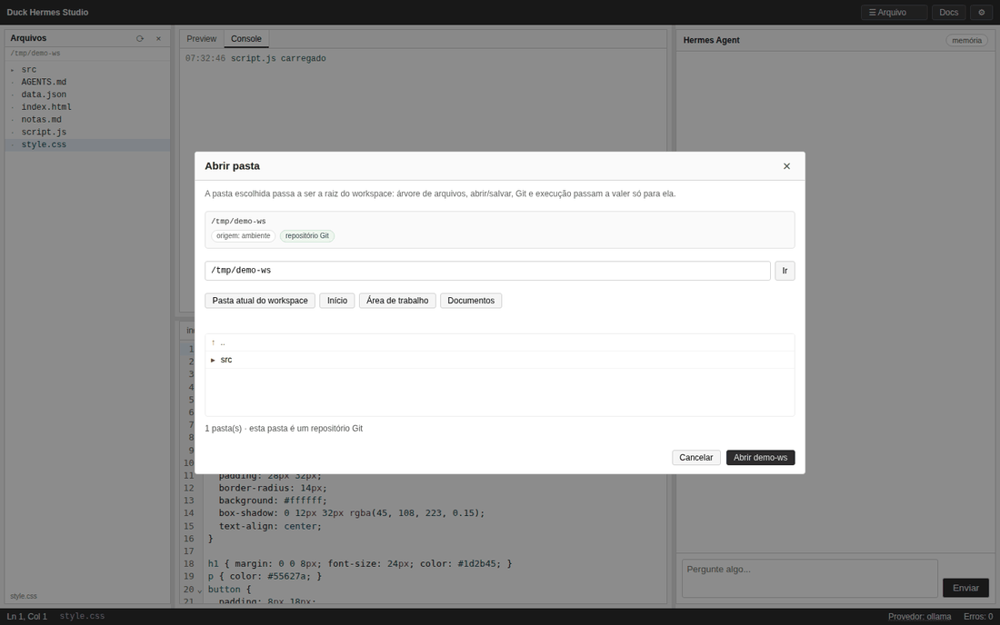
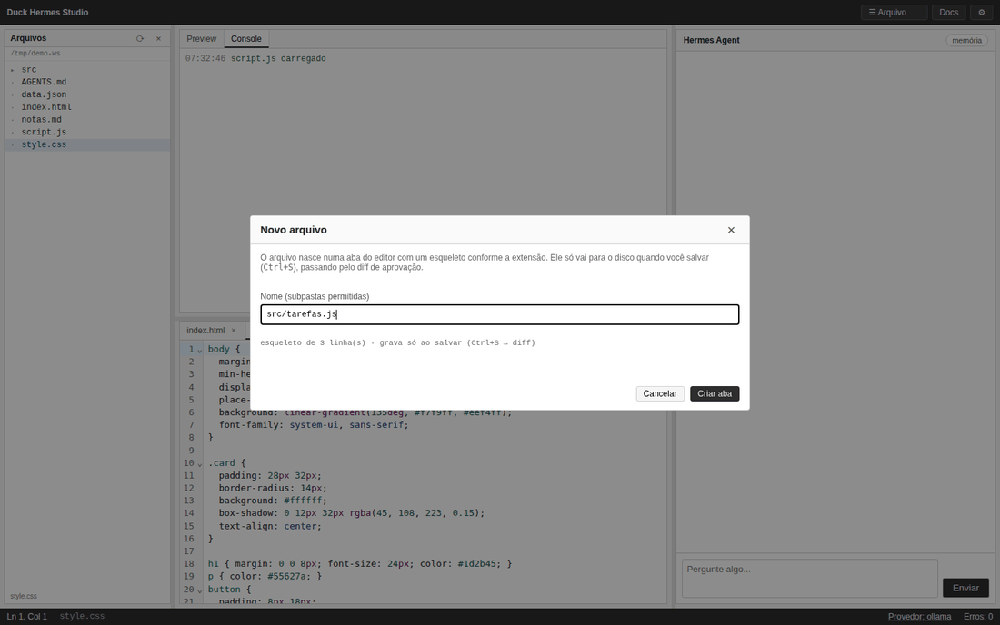
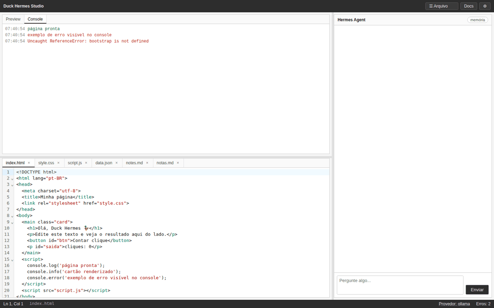
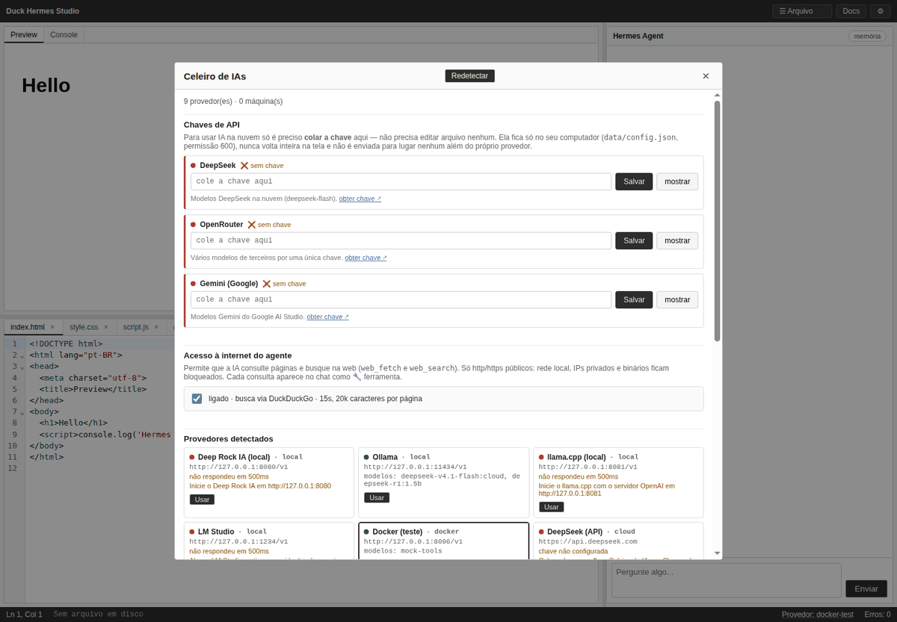
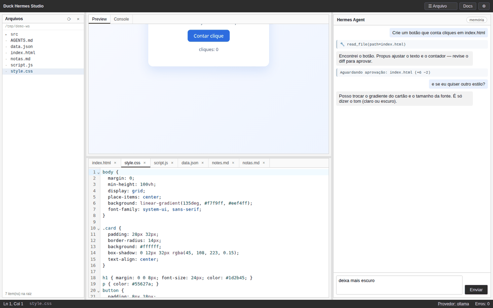
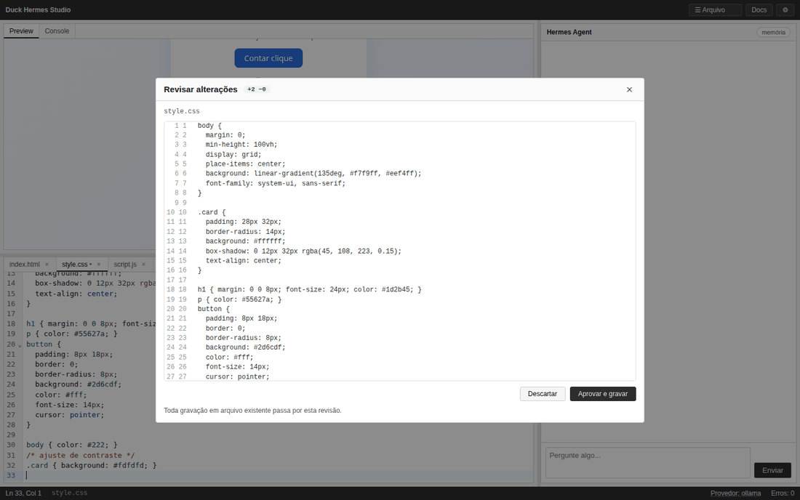
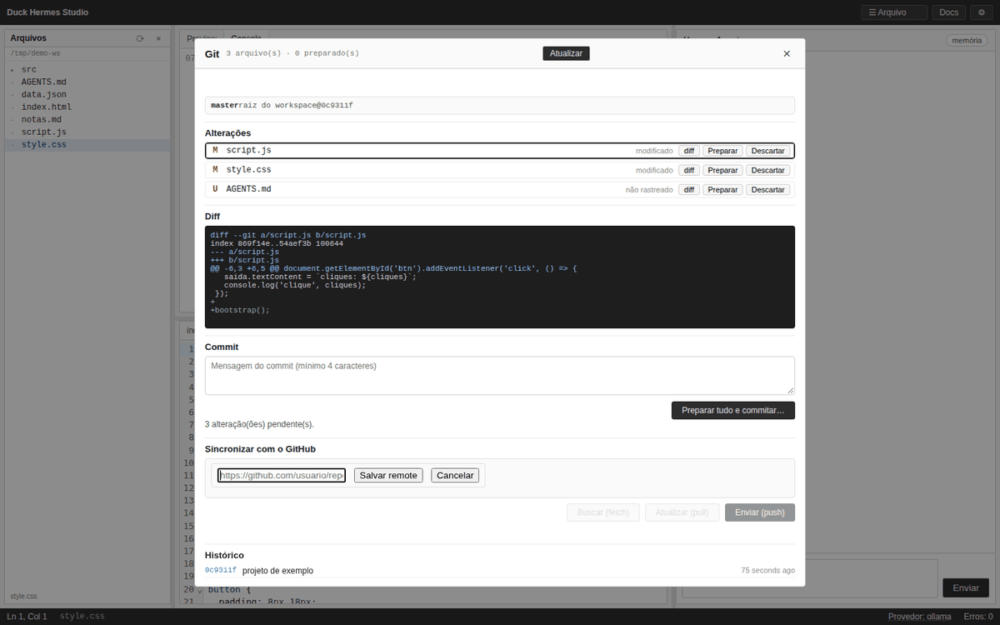

# Duck Hermes Studio

Um editor de código simples e local, com um assistente de IA ao lado. Você escreve no editor, vê o
resultado na hora e — se quiser — conversa com uma IA que pode ler e propor mudanças nos seus arquivos.

- **Funciona sem IA.** Editor, visualização, arquivos, Git e documentação funcionam no modo demo.
- **Nada é gravado sem você aprovar.** Toda alteração vinda da IA aparece como um diff para revisar.
- **Tudo fica no seu computador.** Não há conta, servidor na nuvem nem telemetria.
- **Windows, Linux e macOS**, com instalador pronto ou via Node.js.

> Documentação técnica (endpoints, travas, arquitetura): [README-TECNICO.md](README-TECNICO.md).


*Resultado em cima e editor embaixo, agente à direita, árvore de arquivos opcional à esquerda (oculta por padrão).*

---

## 1. Abrir o programa

### Opção A — baixar o app pronto (não precisa instalar nada)

1. Baixe o arquivo da sua plataforma na página de **Releases** do projeto:
   `duck-hermes-studio-win-x64.exe`, `duck-hermes-studio-linux-x64` ou `duck-hermes-studio-macos-arm64`.
2. Dê permissão de execução e abra:
   - **Windows:** clique duas vezes. Se aparecer o aviso azul do SmartScreen, use
     **Mais informações → Executar assim mesmo**.
   - **macOS:** clique com o botão direito → **Abrir** (o Gatekeeper bloqueia na primeira vez).
   - **Linux:** `chmod +x duck-hermes-studio-linux-x64` e execute.
3. O navegador abre sozinho em `http://localhost:3000`. Se não abrir, acesse esse endereço manualmente.

O app já abre **na pasta em que você o executou**. Para trocar, use **☰ Arquivo → Abrir pasta…**

### Opção B — rodar a partir do código (precisa de Node.js 16+)

```bash
npm install
npm start
```

Depois acesse `http://localhost:3000`.

---

## 2. Primeiros 5 minutos

| Passo | O que fazer |
|---|---|
| **1. Escolher a pasta** | **☰ Arquivo → Abrir pasta…**, navegue e clique em **Abrir <nome>**. Essa pasta passa a ser a raiz de tudo (árvore, salvar, Git). |
| **2. Ver os arquivos** | **☰ Arquivo → Mostrar árvore de arquivos**. Clique em um arquivo para abrir numa aba. |
| **3. Criar um arquivo** | **☰ Arquivo → Novo arquivo…** (`Alt+N`), digite `index.html`, `notas.md`, `app.py`… e clique em **Criar aba**. |
| **4. Salvar** | `Ctrl+S`. Se o arquivo é novo, o app pergunta onde salvar; depois mostra um diff para você **Aprovar e gravar**. |
| **5. Ver o resultado** | O painel de cima mostra o preview de HTML, CSS, Markdown, JSON, YAML, imagens, PDF… |



*O modal abre na pasta atual, mostra atalhos e recentes, e a escolha fica salva para a próxima vez.*

### Seu primeiro "olá"

1. `Alt+N` → `index.html` → **Criar aba** (o esqueleto já vem pronto).
2. `Ctrl+S` → **Salvar como** → **Salvar** → **Aprovar e gravar**.
3. O preview no painel de cima já mostra a página. Edite o texto e use **Executar** (`Ctrl+Enter`).



*O esqueleto vem conforme a extensão; o arquivo só vai para o disco quando você salvar e aprovar o diff.*

### Ver o que aconteceu no console

O painel de cima tem a aba **Console**: cada `console.log`, aviso e erro da sua página aparece com horário,
e o contador **Erros** na barra de baixo é atualizado junto.



### Botões que você mais vai usar

| Ação | Atalho | Onde |
|---|---|---|
| Executar / atualizar o preview | `Ctrl+Enter` | menu Arquivo |
| Abrir arquivo | `Ctrl+O` | menu Arquivo |
| Salvar | `Ctrl+S` | menu Arquivo |
| Novo arquivo | `Alt+N` | menu Arquivo |
| Abrir pasta | — | menu Arquivo |
| Git | `Ctrl+G` | menu Arquivo |
| Abrir o menu | `Alt+F` | barra superior |

A barra de baixo mostra a posição do cursor, o arquivo em disco, o provedor de IA ativo e quantos erros
o console viu. **Provedor: …** é clicável e abre o diagnóstico.

---

## 3. Conectar uma IA (opcional)

O botão **⚙** abre o **Celeiro de IAs**. Ele testa o que existe na sua máquina e mostra ✅ ou ❌ com uma dica:

| Provedor | Precisa de quê |
|---|---|
| Ollama, llama.cpp, LM Studio, Deep Rock IA | programa local rodando (grátis, sem chave) |
| DeepSeek, OpenRouter, Gemini | uma **chave de API** (você cola no próprio app) |
| Docker (teste) | `docker compose -f docker/test-llm/docker-compose.yml up -d --build` |
| Máquinas da rede | cadastro manual de outra máquina |
| **Modo demo** | nada — sempre disponível |



*O ⚙ testa o que existe na máquina, deixa colar a chave de cada provedor de nuvem e ligar/desligar o acesso
do agente à internet.*

### Colar uma chave de API (sem editar arquivo)

1. Abra **⚙** (ou clique em **Provedor: …** na barra inferior).
2. Em **Chaves de API**, encontre o provedor (DeepSeek, OpenRouter ou Gemini).
3. **Cole a chave** no campo e clique em **Salvar**.
4. O app salva, redetecta e o provedor fica ✅. Depois é só clicar em **Usar**.

Detalhes úteis:

- O campo é do tipo senha; **mostrar/ocultar** fica ao lado para conferir a colagem.
- **Remover** apaga a chave salva pelo app.
- O link **obter chave ↗** abre a página oficial do provedor.
- A chave fica só no seu computador, em `data/config.json` (permissão 600) e aparece sempre mascarada
  (`sk-u…cdef`). Ela não é enviada para lugar nenhum além do próprio provedor.
- Se você já usa `DEEPSEEK_API_KEY`/`OPENROUTER_API_KEY`/`GEMINI_API_KEY` no `.env` ou no ambiente, o
  app mostra "vinda do ambiente/.env"; uma chave colada no app tem prioridade e, ao removê-la, o app
  volta a usar a do ambiente.

### Escolher o provedor

Cada cartão tem **Usar**. A escolha fica salva e aparece na barra inferior. **Redetectar** testa tudo
de novo sem reiniciar.

### Modo demo

Sem nenhuma IA configurada nada quebra: o chat responde uma mensagem fixa lembrando de configurar, e
editor, preview, console, árvore de arquivos, abrir/salvar, DevDocs e `AGENTS.md` continuam funcionando.

---

## 4. Conversar com a IA

No painel da direita, escreva e envie (`Ctrl+Enter`). O agente pode:

- **ler** arquivos do projeto para se orientar;
- **propor** alterações — que aparecem como diff (**+** verde, **−** vermelho) para você aprovar ou descartar;
- **recarregar o preview** e **ler os erros** do console;
- **atualizar o `AGENTS.md`**, a "memória" do projeto (botão **memória** no topo do chat);
- **delegar** uma tarefa para outro modelo do celeiro (`delegate`);
- **consultar a internet** (buscar e abrir páginas) — veja a seção abaixo.

### A IA pode consultar a internet

No **⚙ → Celeiro de IAs → Acesso à internet do agente** há um interruptor. Ligado, o agente ganha duas
ferramentas:

| Ferramenta | Para quê |
|---|---|
| `web_search` | procurar na web (DuckDuckGo) e receber títulos, links e trechos |
| `web_fetch` | abrir uma página pública e ler o texto dela |

Cada consulta aparece no chat como `🔧 web_fetch(url=...)` — você vê exatamente o que foi pedido. Limites:
15 segundos por página, 20 mil caracteres por leitura (dá para pedir menos) e até 8 resultados por busca.

O que **não** acontece: a ferramenta recusa `localhost`, IPs da sua rede (10.x, 192.168.x, 169.254.x…),
arquivos locais (`file://`), páginas com usuário/senha na URL e downloads binários (imagens, PDFs, zips).
Ou seja, ela não serve de atalho para acessar o seu computador ou a sua rede interna.

Se a busca gratuita falhar (o provedor às vezes limita), use `web_fetch` numa URL conhecida ou aponte o app
para um **SearXNG** seu com `HERMES_SEARCH_URL=https://seu-searxng`. Desligar o interruptor vale na hora.



*O feed mostra a conversa e cada ferramenta usada (`🔧 nome(...)`); alterações propostas aparecem para revisão.*

Nada é gravado até você clicar em **Aprovar e gravar**. Se descartar, o arquivo fica intacto:



*Linhas removidas em vermelho, adicionadas em verde. **Aprovar e gravar** aplica; **Descartar** (ou `Esc`) não toca no arquivo.*

---

## 5. Git e GitHub (opcional)

### Conta do GitHub

1. Crie um token em <https://github.com/settings/tokens> (fine-grained) com permissão
   **Contents: read and write** no repositório que você quer usar.
2. **☰ Arquivo → Conta do GitHub…**, cole o token, preencha nome/e-mail dos commits e clique em
   **Validar e salvar**.

O token é validado no GitHub antes de salvar, fica no seu computador com permissão 600 e nunca volta
inteiro para a tela.

### Comitar e sincronizar

**☰ Arquivo → Git…** (`Ctrl+G`):

| Botão | O que faz |
|---|---|
| **Preparar** / **Desfazer** | escolhe quais arquivos entram no próximo commit |
| **Descartar** | joga fora as mudanças de um arquivo (com confirmação) |
| **diff** | mostra o que mudou |
| **Preparar tudo e commitar…** | pede a mensagem, depois **Confirmar commit** |
| **Buscar (fetch)** | só olha se há novidades no GitHub |
| **Atualizar (pull)** | traz as novidades (só se der para aplicar direto) |
| **Enviar (push)** | manda seus commits (pede confirmação) |



*Status, arquivos com **Preparar**/**Descartar**, diff colorido, commit em duas etapas e a seção de sincronização.*

Se a pasta ainda não é um repositório, o painel avisa e sugere `git init`. O app **não** faz merge,
rebase nem `reset --hard` — decisões delicadas ficam para o Git de verdade.

---

## 6. Diagnósticos, sandbox e plugins

**Diagnósticos.** Com o arquivo salvo, use **☰ Arquivo → Diagnósticos do arquivo**. O app conversa com o
language server da linguagem (TypeScript, Python, Rust ou JSON) e escreve os erros no **Console**; clique
num deles para pular para a linha. Se o servidor não estiver instalado, ele diz qual falta — não inventa
resultado. O mesmo vale para a saída de compiladores: ao executar com erro, os diagnósticos aparecem
abaixo da saída e são clicáveis.

**Sandbox.** No visualizador Python, além de **Executar arquivo** existe **Executar em sandbox (Docker)**:
o comando roda num container descartável, sem rede, sem capabilities e com limite de memória/CPU. O modo
normal roda no seu usuário, sem isolamento — o modal de aprovação mostra isso em letras claras, e o
resultado também. Sem Docker instalado, o botão explica o que falta em vez de tentar.

**Plugins.** Em **⚙ → Plugins** aparecem os arquivos `.plg.js` de `data/plugins` e da pasta `plugins/` do
workspace. Nada é carregado sozinho: você escolhe **Carregar**. Ao carregar, as ferramentas do plugin ficam
disponíveis para a IA; ao descarregar, são revogadas. Um plugin que falha é isolado e não derruba o editor.
O arquivo `plugins/exemplo.plg.js` mostra o contrato (ele expõe `package_info`).

**Árvore sem ruído.** O botão **◉** no topo da árvore oculta o que está no `.gitignore` (node_modules,
build, caches). Clique de novo para ver tudo.

---

## 7. Onde ficam minhas coisas

| O quê | Onde |
|---|---|
| Seus arquivos | na pasta escolhida em **Abrir pasta** |
| Abas e rascunhos não salvos | no navegador (`localStorage`) |
| Máquinas, histórico, devdocs, chaves e conta | `data/` do projeto — ou, no app pronto: `%APPDATA%\DuckHermesStudio` (Windows), `~/Library/Application Support/DuckHermesStudio` (macOS), `~/.local/share/duck-hermes-studio` (Linux) |
| Memória do projeto | `AGENTS.md` na raiz do workspace |

Para usar outra pasta de dados no app pronto: `duck-hermes-studio --data /caminho`. Para abrir já numa
pasta específica: `--workspace /caminho`. `--help` lista tudo.

---

## 8. Problemas comuns

| Sintoma | Solução |
|---|---|
| O navegador não abriu | acesse `http://localhost:3000`; se a porta estiver ocupada use `--port 3100` |
| "Porta em uso" ao iniciar | feche a outra instância ou rode com `--port 3001` |
| IA não aparece | **⚙ → Redetectar**; provedor local precisa estar rodando (ex.: `ollama serve`) |
| "chave não configurada" | cole a chave em **⚙ → Chaves de API** e clique em **Salvar** |
| A IA responde erro 401/402 | chave errada/expirada ou sem créditos no provedor |
| Preview em branco | clique em **Executar** (`Ctrl+Enter`) ou veja a aba **Console** |
| "Somente leitura" ao salvar | imagem, PDF e binário só são visualizados — edite um arquivo de texto |
| Git diz que a pasta não é repositório | rode `git init` na pasta escolhida |
| Push/pull reclamam de autenticação | configure a conta em **☰ Arquivo → Conta do GitHub…** |
| A IA diz que a internet está desativada | ligue em **⚙ → Celeiro de IAs → Acesso à internet do agente** |
| A busca na web não retorna nada | tente outra consulta, use `web_fetch` numa URL ou configure `HERMES_SEARCH_URL` (SearXNG) |
| `web_fetch` recusa uma URL | endereços locais/internos e `file://` são bloqueados por segurança |
| Gatekeeper/SmartScreen bloqueiam | macOS: botão direito → **Abrir**; Windows: **Mais informações → Executar assim mesmo** |
| "language server não instalado" | instale o binário indicado (ex.: `npm i -g typescript-language-server`) — o app não baixa nada sozinho |
| Sandbox diz que o Docker não responde | instale/abra o Docker, ou use o modo local ciente de que ele não isola |

Não há assinatura de código nos binários (isso exige certificados pagos), por isso esses avisos aparecem
na primeira execução.

---

## 9. Privacidade e segurança, em português claro

- O programa roda **na sua máquina**; o servidor escuta só em `127.0.0.1` (ninguém da rede acessa).
- Só há conversa com a internet quando **você** usa um provedor de nuvem, o GitHub ou (se ligar o
  interruptor) quando **você pede** ao agente para consultar algo na web — nesse caso o termo buscado ou a
  URL vão para o buscador/site consultado.
- Chaves e token ficam em `data/config.json` com permissão **600** (só o seu usuário lê). Em computador
  compartilhado, prefira usar `.env`/variáveis de ambiente e o botão **Remover**.
- `data/` e os arquivos `.env` **não** são acessíveis pela árvore, pelo agente nem por `/api/fs/*`, mesmo
  quando a pasta de dados está dentro do workspace. A árvore nem lista `data/`.
- O modo **local** de execução não é um sandbox: a proteção é a aprovação. Para isolamento de verdade, use
  **Executar em sandbox** (Docker) ou rode o app dentro de um container.
- O app **nunca** executa `sudo`, `rm -rf /` nem comandos fora da pasta do projeto; execução de código
  pede aprovação e tem tempo limite.
- Toda escrita em arquivo passa por um diff de aprovação.

---

## Licença

MIT. Veja [LICENSE](LICENSE).
